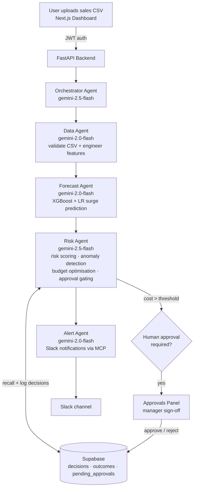

# Pharma Supply Intelligence Agent v3

A production-grade, 5-agent AI system for pharmaceutical supply-chain management.

## Architecture



**Pipeline:** CSV Upload → Data Agent → Forecast Agent → Risk Agent → Alert Agent, coordinated by the Orchestrator. High-value orders pause for human approval (long-running operation); every decision is logged to Supabase so the Risk Agent learns from past false-positive surges (long-term memory).

| Agent | Model | Responsibility |
|-------|-------|----------------|
| Data Agent | gemini-2.0-flash | Validate CSV, engineer features |
| Forecast Agent | gemini-2.0-flash | XGBoost + LR surge prediction |
| Risk Agent | gemini-2.5-flash | Anomaly detection, budget optimisation, approval gating |
| Alert Agent | gemini-2.0-flash | Slack notifications |
| Orchestrator | gemini-2.5-flash | Pipeline coordination |

## Course Concepts Demonstrated

| Concept | Where |
|---------|-------|
| Multi-agent system (ADK) | `agents/` — 4 sequential sub-agents coordinated by a root orchestrator (`agents/orchestrator.py`) |
| MCP Server | `mcp/slack_setup.py` — Slack MCP server for agent notifications |
| Custom tools | `tools/` — 7 tool modules (forecasting, risk, anomaly, memory, approvals, alerts, data) |
| Long-running operations | Human-in-the-loop approval gate: orders above threshold pause as `pending_approvals` and resume on manager sign-off (`api/approvals.py`) |
| Sessions & long-term memory | Supabase-backed decision memory: `recall_past_decisions` / `log_decision` in `tools/memory_tools.py` temper confidence using historical false-surge rates |
| Security features | JWT auth (`api/auth.py`), role-based approval, all secrets in `.env` (never committed), CORS restrictions |
| Deployability | `Dockerfile` for containerised deployment (Cloud Run-ready) |
| Gemini | All 5 agents powered by Gemini 2.0/2.5 Flash |

## Drug Categories (8 ATC)

`M01AB` `M01AE` `N02BA` `N02BE` `N05B` `N05C` `R03` `R06`

## Quick Start

### 1. Python Backend

```bash
# Copy and configure environment
cp .env.example .env
# Edit .env with your GOOGLE_API_KEY, SUPABASE_URL, SUPABASE_KEY, SLACK_BOT_TOKEN

# Install dependencies
pip install -r requirements.txt

# Create Supabase tables (run db/schema.sql in your Supabase SQL editor)

# Train ML models (one-time)
python -m ml.train
python -m ml.train_anomaly

# Start the API server
uvicorn api.main:app --reload --host 0.0.0.0 --port 8000
```

### 2. Next.js Frontend

```bash
cd frontend
npm run dev
# Open http://localhost:3000
# Login with the ADMIN_PASSWORD / MANAGER_PASSWORD credentials you set in .env
```

### 3. Docker

```bash
docker build -t pharma-supply .
docker run -p 8000:8000 --env-file .env pharma-supply
```

## Supabase Tables

Run `db/schema.sql` in your Supabase SQL editor to create:
- `decisions` — all ordering decisions with status
- `outcomes` — actual vs predicted accuracy tracking
- `pending_approvals` — high-value orders awaiting manager sign-off

## API Endpoints

| Method | Path | Description |
|--------|------|-------------|
| POST | `/api/auth/token` | Get JWT token |
| POST | `/api/run-pipeline` | Upload CSV and run full pipeline |
| GET  | `/api/approvals` | List pending approvals |
| POST | `/api/approve/{id}` | Approve or reject a held order |
| GET  | `/api/decisions` | Recent decision history |
| GET  | `/api/budget` | Current budget and threshold |

## Environment Variables

See `.env.example` for all required variables.

## Project Structure

```
capstone project/
├── data/
│   └── salesdaily.csv          # Pharma sales dataset (2014-2019)
├── ml/
│   ├── train.py                # Train XGBoost + LR forecast models
│   ├── train_anomaly.py        # Train IsolationForest anomaly models
│   └── models/                 # Saved .pkl model files
├── db/
│   ├── supabase_client.py      # Supabase connection
│   └── schema.sql              # Database table DDL
├── tools/                      # Agent tool functions
├── agents/                     # ADK agent definitions + orchestrator
├── api/                        # FastAPI backend
├── mcp/                        # MCP Slack server setup
├── frontend/                   # Next.js dashboard
├── requirements.txt
├── .env.example
└── Dockerfile
```
