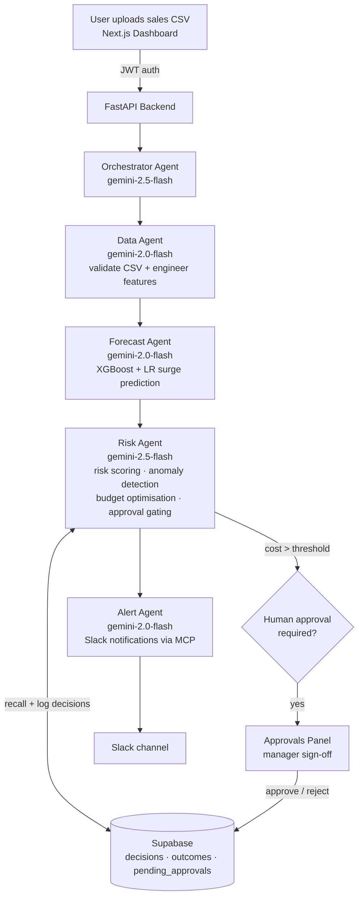

# Pharma Supply Intelligence Agent

A multi-agent AI system for pharmaceutical inventory planning. Upload daily sales, and five Gemini agents validate the data, forecast demand for 8 drug categories, score surge and budget risk, hold expensive orders for manager approval, and post alerts to Slack.

Uses Google ADK, FastAPI, Next.js, and Supabase, containerized for Google Cloud Run. Built with Minahil Saba for a Kaggle AI agents capstone (Agents for Business track).

## Architecture



**Pipeline:** CSV Upload → Data Agent → Forecast Agent → Risk Agent → Alert Agent, coordinated by the Orchestrator. High-value orders pause for human approval (long-running operation); every decision is logged to Supabase so the Risk Agent learns from past false-positive surges (long-term memory).

| Agent | Model | Responsibility |
|-------|-------|----------------|
| Data Agent | gemini-2.0-flash | Validate CSV, engineer features |
| Forecast Agent | gemini-2.0-flash | XGBoost + LR surge prediction |
| Risk Agent | gemini-2.5-flash | Anomaly detection, budget optimisation, approval gating |
| Alert Agent | gemini-2.0-flash | Slack notifications |
| Orchestrator | gemini-2.5-flash | Pipeline coordination |

## Results

Evaluated with `python -m ml.evaluate`: models are trained on 2014 to 2018 and scored on one-day-ahead forecasts for the final 365 days (October 2018 to October 2019), using the same features and settings as production.

**Demand forecasting** (averaged over the 8 drug categories; WAPE is total absolute error divided by total sales)

| Model | MAE (units/day) | RMSE | WAPE |
|---|---|---|---|
| Seasonal naive (same day last week) | 4.45 | 5.94 | 0.565 |
| Naive (yesterday) | 4.44 | 5.94 | 0.564 |
| 7-day moving average | 3.45 | 4.56 | 0.438 |
| XGBoost | 3.38 | 4.51 | 0.430 |
| **XGBoost + Random Forest ensemble (used by the app)** | **3.33** | **4.42** | **0.423** |

The ensemble cuts error by 25% against the seasonal naive baseline and beats every baseline in 7 of 8 categories. Its edge over a 7-day moving average is small (about 3%), because daily pharmacy sales are noisy and most predictable signal is the recent level. Accuracy is best for high-volume N02BE (WAPE 0.31) and weakest for sparse N05C and R03, where many days have zero sales.

**Surge detection** (day in the top quartile of training-period sales)

The logistic regression surge classifier reaches ROC-AUC 0.85 for N02BE and 0.78 for R06, but averages 0.64 across categories, and its F1 beats a simple moving-average rule in 6 of 8. Evaluating it led to one change: training with `class_weight="balanced"`, which raised average F1 from 0.22 to 0.40 at the same ROC-AUC. Because surge flags feed the Risk Agent, the human approval gate on large orders is an important safeguard rather than a formality.

Full tables are in [`results/`](results/).

## Design decisions

| Decision | Why | Where |
|---|---|---|
| Five specialized agents under one orchestrator | Each agent has a narrow job and its own tools, which keeps prompts short and failures easy to trace | `agents/` |
| Classical ML for the numbers, LLMs for orchestration and explanation | Forecasts need to be reproducible and measurable; the agents call ML tools instead of estimating volumes themselves | `ml/`, `tools/forecast_tools.py` |
| Human approval for orders above a cost threshold | Surge predictions are imperfect (see Results), so high-cost decisions pause as `pending_approvals` until a manager signs off | `api/approvals.py` |
| Decision memory in Supabase | The Risk Agent recalls past decisions and their outcomes, and lowers its confidence for drugs with a history of false surges | `tools/memory_tools.py` |
| Slack alerts through an MCP server | Notifications go through a standard tool interface instead of custom API code | `mcp/slack_setup.py` |
| Fail-fast secrets, JWT auth, and role-based approval | The API refuses to start without its secrets, and only managers can approve held orders | `api/auth.py`, `api/approvals.py` |
| Models trained at build time | Model files are generated from the data in the Docker build instead of being committed | `Dockerfile` |

## Drug Categories (8 ATC)

`M01AB` `M01AE` `N02BA` `N02BE` `N05B` `N05C` `R03` `R06`

## Quick Start

### 1. Python Backend

```bash
# Copy and configure environment
cp .env.example .env
# Edit .env with your GOOGLE_API_KEY, SUPABASE_URL, SUPABASE_KEY, SLACK_BOT_TOKEN

# Install dependencies
pip install -r requirements.txt

# Create Supabase tables (run db/schema.sql in your Supabase SQL editor)

# Train ML models (one-time; writes to ml/models/)
python -m ml.train
python -m ml.train_anomaly

# Optional: reproduce the evaluation tables in results/
python -m ml.evaluate

# Start the API server
uvicorn api.main:app --reload --host 0.0.0.0 --port 8000
```

### Tests

```bash
pip install -r requirements-dev.txt
pytest
```

The tests cover login, fail-fast secret handling, manager-only approvals, and that forecast features use only past data.

### 2. Next.js Frontend

```bash
cd frontend
npm run dev
# Open http://localhost:3000
# Login with the ADMIN_PASSWORD / MANAGER_PASSWORD credentials you set in .env
```

### 3. Docker

```bash
docker build -t pharma-supply .
docker run -p 8000:8000 --env-file .env pharma-supply
```

### 4. Deploy to Google Cloud Run

The container reads Cloud Run's injected `$PORT`, so deployment is a single command
(run from a clone of this repo in Cloud Shell or with the gcloud CLI):

```bash
gcloud services enable run.googleapis.com cloudbuild.googleapis.com artifactregistry.googleapis.com

gcloud run deploy pharma-supply-api \
  --source . \
  --region us-central1 \
  --allow-unauthenticated \
  --memory 2Gi \
  --set-env-vars "GOOGLE_API_KEY=<key>,SUPABASE_URL=<url>,SUPABASE_KEY=<key>,SECRET_KEY=<secret>,ADMIN_PASSWORD=<pw>,MANAGER_PASSWORD=<pw>,PROCUREMENT_BUDGET=50000,APPROVAL_THRESHOLD=10000,SLACK_BOT_TOKEN=<token>,SLACK_TEAM_ID=<team>,SLACK_CHANNEL=#supply-chain"
```

Secrets are passed as Cloud Run environment variables; `.env` is git-ignored and never
baked into the image. After deploying, verify at `<service-url>/` (health check) and
`<service-url>/docs` (interactive API). To point the frontend at the deployed API, set
`NEXT_PUBLIC_API_URL=<service-url>` and add your frontend origin to `ALLOWED_ORIGIN`.

## Supabase Tables

Run `db/schema.sql` in your Supabase SQL editor to create:
- `decisions`: all ordering decisions with status
- `outcomes`: actual vs predicted accuracy tracking
- `pending_approvals`: high-value orders awaiting manager sign-off

## API Endpoints

| Method | Path | Description |
|--------|------|-------------|
| POST | `/api/auth/token` | Get JWT token |
| POST | `/api/run-pipeline` | Upload CSV and run full pipeline |
| GET  | `/api/approvals` | List pending approvals |
| POST | `/api/approve/{id}` | Approve or reject a held order |
| GET  | `/api/decisions` | Recent decision history |
| GET  | `/api/budget` | Current budget and threshold |

## Environment Variables

See `.env.example` for all required variables.

## Project Structure

```
pharma-supply-agent/
├── data/
│   └── salesdaily.csv          # Pharma sales dataset (2014-2019)
├── ml/
│   ├── train.py                # Train XGBoost + LR forecast models
│   ├── train_anomaly.py        # Train IsolationForest anomaly models
│   ├── evaluate.py             # Hold-out evaluation vs naive baselines
│   └── models/                 # Trained models (generated, git-ignored)
├── db/
│   ├── supabase_client.py      # Supabase connection
│   └── schema.sql              # Database table DDL
├── tools/                      # Agent tool functions
├── agents/                     # ADK agent definitions + orchestrator
├── api/                        # FastAPI backend
├── mcp/                        # MCP Slack server setup
├── frontend/                   # Next.js dashboard
├── results/                    # Evaluation tables
├── tests/                      # pytest suite
├── requirements.txt
├── .env.example
└── Dockerfile
```

## AI assistance

I used Claude (Anthropic) to review this repository from a hiring manager's perspective and to help implement the holdout evaluation (`ml/evaluate.py`), the pytest suite, the manager-only approval check, and fail-fast secret handling. I ran the evaluation and tests myself, reviewed every change, and can explain each one. The agent system, API, and dashboard were built by Minahil Saba and me for the Kaggle capstone.
